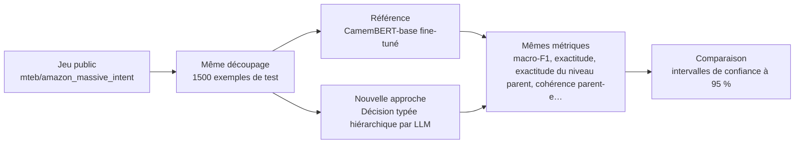
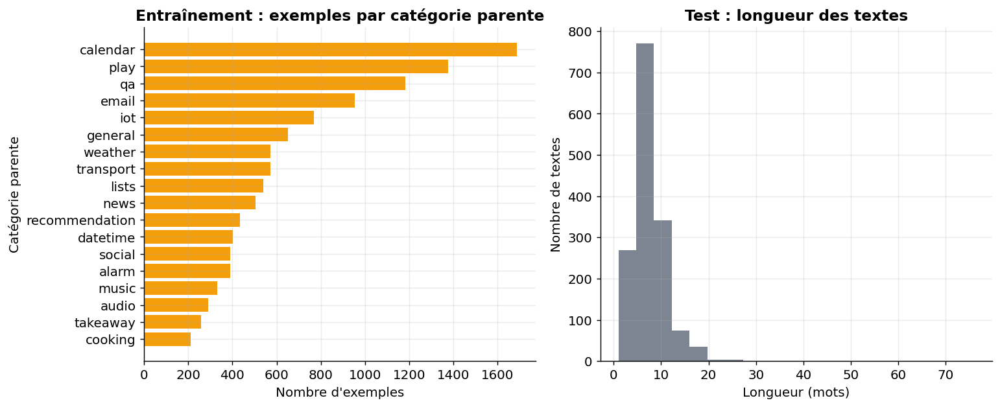
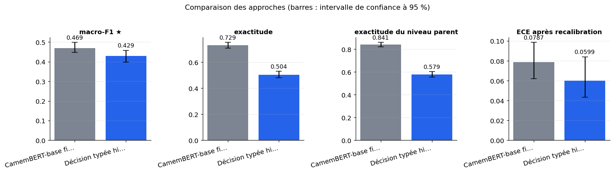
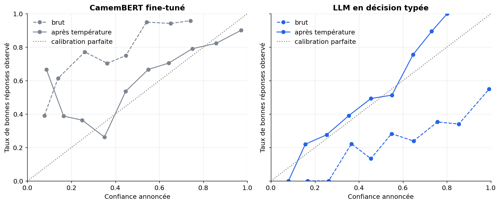
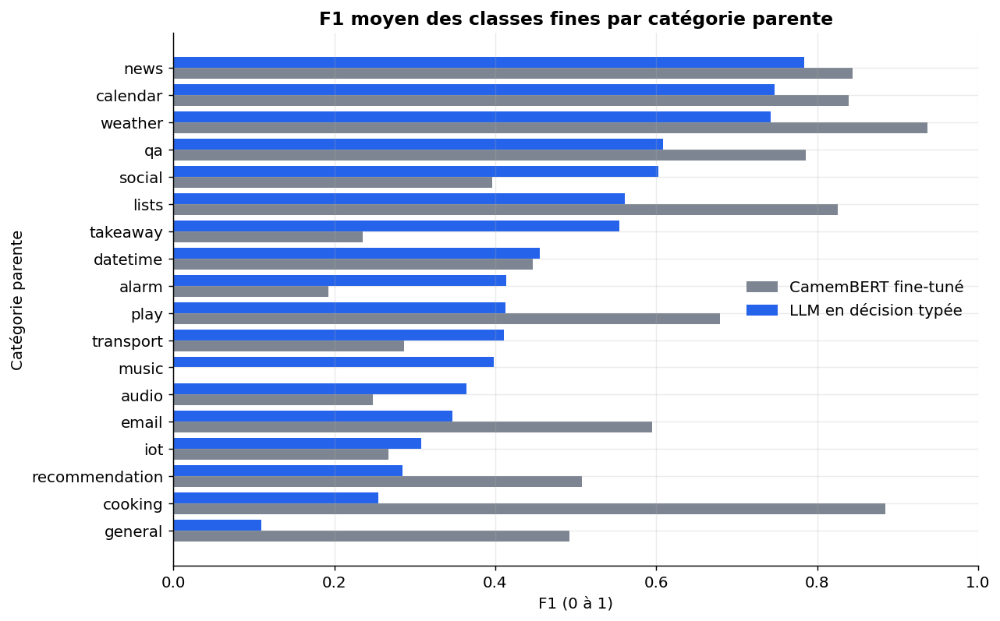

# Un petit LLM en décision typée (distribution sur options) rivalise-t-il avec CamemBERT fine-tuné sur des intentions françaises hiérarchisées ?

> **En bref.** Le LLM zéro-shot paraît proche de CamemBERT sur le macro-F1, mais il est nettement moins exact et très instable à l'ordre des options. La référence, probablement sous-entraînée, favorise le LLM. macro-F1 : 0,429 [0,398 ; 0,458] pour Décision typée hiérarchique par LLM, contre 0,469 [0,447 ; 0,499] pour CamemBERT-base fine-tuné (1500 exemples de test, échelle complète).

## Sommaire

1. [La question](#la-question)
2. [Le protocole](#le-protocole)
3. [Les résultats](#les-résultats)
4. [Ce qu'il faut retenir](#ce-quil-faut-retenir)
5. [Rejouer l'expérience](#rejouer-lexpérience)
6. [Contenu du dépôt](#contenu-du-dépôt)
7. [Références](#références)
8. [Glossaire](#glossaire)

## La question

Peut-on confier le classement de messages en français à un petit modèle de langage, sans l'entraîner, au lieu d'entraîner un classifieur spécialisé sur des milliers d'exemples annotés ? La nouvelle approche ne laisse pas le modèle rédiger de réponse. On lui présente une liste d'options codées (A, B, C…) et on lit directement ses probabilités pour chaque code : d'abord la catégorie générale, puis l'intention précise. Ces probabilités sont ensuite corrigées pour mieux refléter la vraie chance d'avoir raison, et on vérifie que la réponse ne change pas quand on mélange l'ordre des options. La comparaison avec CamemBERT entraîné indique si l'écart de précision est assez faible pour démarrer sans annotations, ou si le classifieur entraîné reste indispensable.

**Hypothèse testée.** En zéro-shot hiérarchique avec recalibration, un LLM ≤ 3 Md atteint un macro-F1 à moins de 10 points de CamemBERT-base fine-tuné sur 60 intentions MASSIVE fr, avec une ECE < 0,10 après recalibration et ≥ 95 % de décisions identiques quand l'ordre des options est mélangé.

| | Référence | Nouvelle approche |
|---|---|---|
| **Approche** | CamemBERT-base fine-tuné | Décision typée hiérarchique par LLM |
| **Principe** | Classifieur plat à 60 classes, encodeur français fine-tuné avec entropie croisée. | Le LLM ne génère pas de texte : on lit la distribution de probabilité sur des codes d'options à un caractère, d'abord pour le scénario (18) puis pour l'intention parmi celles du scénario, et on multiplie les probabilités. |
| **Mise en œuvre** | transformers AutoModelForSequenceClassification, almanach/camembert-base, 3 époques, lr 3e-5, batch 32, longueur max 64, graine 0 ; probabilités softmax brutes puis mise à l'échelle par température ajustée sur validation. | transformers AutoModelForCausalLM ; prompt avec liste d'options codées (A-Z, a-z, 0-9), logits restreints aux codes d'options au dernier jeton, softmax ; deux niveaux hiérarchiques ; recalibration par température ajustée sur validation ; test d'ordre avec 3 permutations aléatoires des options ; mesure de latence. |
| **Modèles** | [`almanach/camembert-base`](https://huggingface.co/almanach/camembert-base) | [`Qwen/Qwen2.5-3B-Instruct`](https://huggingface.co/Qwen/Qwen2.5-3B-Instruct) |

## Le protocole



- **Données** : [`mteb/amazon_massive_intent`](https://huggingface.co/datasets/mteb/amazon_massive_intent) (configuration `fr`), évaluation sur le découpage `test` (1500 exemples). Intentions en français à 60 classes « scénario_intention » dont l'arbre à deux niveaux (18 scénarios) donne un proxy de motif → sous-motif avec classes voisines.
- **Écarts avec des données réelles** : Énoncés courts d'assistant virtuel, 60 classes au lieu de ~300, domaine généraliste, pas d'e-mails ni de pièces jointes, classes peu déséquilibrées ; protocole à valider ensuite sur des données internes.
- **Déroulé** : Jeu public MASSIVE en français (mteb/amazon_massive_intent, config fr) : 60 intentions regroupées en 18 scénarios, qui servent de catégories parentes. CamemBERT-base est fine-tuné sur le split train (3 époques, taux 3e-5, lots de 32, 64 jetons au plus) ; le LLM Qwen2.5-3B-Instruct est utilisé en zéro-shot, avec une décision à deux niveaux lue sur les probabilités des codes d'options. Pour les deux approches, une température est ajustée sur le split validation puis appliquée au test (ECE avant et après, 10 bacs). Les mêmes 1 500 énoncés du split test servent à mesurer macro-F1, exactitude, exactitude parente, cohérence, ECE, Brier et latence p50/p95 sur des textes traités un par un ; les intervalles de confiance viennent d'un bootstrap à 1 000 tirages. La stabilité à l'ordre est mesurée sur 300 textes avec 3 permutations aléatoires des options. Dans l'environnement cible, le même code découpe les données par date et par groupe de clients, et le LLM est appelé via le service interne.
- **Deux échelles, un seul code** : l'échelle réduite (200 exemples, CPU, 10 min) valide la mécanique ; l'échelle complète (GPU T4 (Google Colab), 13 min) donne les résultats.



*À gauche, le nombre d'exemples d'entraînement par catégorie parente : une barre courte signale une catégorie peu représentée. À droite, la longueur des textes de test en mots : des textes courts laissent peu d'indices aux deux approches.*

**Les métriques**

| Métrique | Ce qu'elle mesure | Meilleur si |
|---|---|---|
| macro-F1 ★ | Moyenne du F1 de chaque classe : chaque intention compte autant, qu'elle soit rare ou fréquente. | plus haut |
| exactitude | Part des messages dont l'intention fine est correctement prédite. | plus haut |
| exactitude du niveau parent | Part des messages rangés dans la bonne catégorie de premier niveau. | plus haut |
| cohérence parent-enfant | Part des cas où l'intention prédite appartient bien à la catégorie parente prédite ; sans objet (None) quand le décodage la garantit par construction. | plus haut |
| ECE après recalibration | Écart moyen entre la confiance annoncée et le taux réel de bonnes réponses, après correction par température ajustée sur la validation. | plus bas |
| ECE avant recalibration | Même écart, mesuré sur les probabilités brutes du modèle : il révèle la surconfiance native. | plus bas |
| score de Brier | Erreur quadratique entre les probabilités annoncées et la bonne réponse, qui combine justesse et calibration. | plus bas |
| accord sous permutation des options | Part des décisions inchangées quand on mélange l'ordre des options présentées au LLM ; sans objet pour un classifieur sans liste d'options. | plus haut |
| latence p50 (ms) | Temps médian, en millisecondes, pour décider d'un message traité seul. | plus bas |

★ métrique principale : c'est elle qui tranche la question.

## Les résultats

| Approche | macro-F1 ★ ↑ | exactitude ↑ | exactitude du niveau parent ↑ | cohérence parent-enfant ↑ | ECE après recalibration ↓ | ECE avant recalibration ↓ | score de Brier ↓ | accord sous permutation des options ↑ | latence p50 (ms) ↓ | Latence médiane (ms) ↓ |
|---|---|---|---|---|---|---|---|---|---|---|
| CamemBERT-base fine-tuné (référence) | **0,469 [0,447 ; 0,499]** | **0,729 [0,707 ; 0,752]** | **0,841 [0,821 ; 0,86]** | 0,941 [0,928 ; 0,953] | 0,0787 [0,0619 ; 0,0986] | **0,381 [0,359 ; 0,402]** | **0,397 [0,37 ; 0,426]** | — | **8,4** | 8,4 |
| Décision typée hiérarchique par LLM (nouvelle approche) | 0,429 [0,398 ; 0,458] | 0,504 [0,48 ; 0,53] | 0,579 [0,556 ; 0,603] | — | **0,0599 [0,0433 ; 0,0841]** | 0,436 [0,411 ; 0,459] | 0,704 [0,679 ; 0,726] | 0,49 [0,448 ; 0,532] | 137 | 137 |

★ métrique principale · ↑ plus haut = meilleur · ↓ plus bas = meilleur · entre crochets : intervalle de confiance à 95 % (bootstrap) · en gras : la meilleure valeur.



*Macro-F1, exactitude (classe fine et parente) et ECE après recalibration, avec intervalles de confiance à 95 %. Plus haut = mieux, sauf pour l'ECE (plus bas = mieux).*



*Diagramme de fiabilité de chaque approche : un point sous la diagonale signale une confiance trop élevée. Tirets : probabilités brutes ; trait plein : après recalibration par température.*



*F1 moyen des classes fines, par catégorie parente et par approche. Les catégories du bas sont celles où le LLM en décision typée est le plus faible.*

**Lecture** (confiance moyenne). À l'échelle complète (phase publique, 1 500 énoncés de test, GPU), le LLM zéro-shot de 3 Md reste à 4 points de macro-F1 de CamemBERT (0,43 contre 0,47), mais l'exactitude chute de 72,9 % à 50,4 % et la parente est fausse dans 42 % des cas, contre 13 %. L'ECE passe sous 0,10 après recalibration (0,06), au prix de probabilités très aplaties (Brier 0,70 contre 0,40). L'accord sous permutation des options n'est que de 49 %, très loin des 95 % visés. La référence est probablement sous-entraînée, ce qui flatte le LLM. Un classifieur entraîné reste donc préférable dès qu'il existe des étiquettes, et l'approche par LLM n'est pas prête sans correction du biais d'ordre.

## Ce qu'il faut retenir

**Réserves**

- Ne pas lire « à 4 points de CamemBERT » comme une quasi-équivalence. Sur le routage effectif, le LLM se trompe de catégorie parente dans plus de 4 cas sur 10, contre un peu plus de 1 sur 10 pour CamemBERT.
- CamemBERT est ici sous-exploité, et l'écart réel avec le LLM est probablement plus grand que celui mesuré, en particulier sur le macro-F1. Les 4 points sont une borne basse de l'avantage d'un classifieur entraîné.
- La décision du LLM dépend fortement de l'ordre de présentation des options. Une moitié des décisions change quand on mélange cet ordre, donc les chiffres de précision du LLM sont fragiles et ne sont pas exploitables en production telle quelle.
- Le passage de l'ECE sous 0,10 ne signifie pas que la confiance du LLM est utile pour décider seul ou escalader. Après recalibration, ses probabilités sont proches de l'indécision, et son Brier est bien moins bon que celui de CamemBERT.

**Limites**

- MASSIVE contient des énoncés courts d'assistant virtuel répartis en 60 classes peu déséquilibrées. Les messages réels sont plus longs et plus nombreux en classes (environ 300) : les écarts mesurés ici ne se transposent pas tels quels.
- Le décodage hiérarchique n'explore qu'une branche. Une erreur au premier niveau est irrattrapable, et les probabilités des branches non explorées sont réparties uniformément, ce qui approxime la calibration et le score de Brier.
- Les noms d'options proviennent des étiquettes (en anglais pour MASSIVE) et ne sont accompagnés d'aucune description. Des libellés plus explicites pourraient changer nettement le résultat du LLM.
- Une seule température est partagée par les deux niveaux, et la recalibration exige des exemples étiquetés de validation. Le LLM n'est donc pas entièrement « sans annotation » si l'on veut des probabilités fiables.
- Si le service interne ne fournit pas les log-probabilités, l'approche se replie sur la réponse écrite. Les probabilités deviennent alors grossières, et la calibration comme l'ECE perdent leur sens.

**Pistes d'amélioration**

- Les intervalles de confiance du macro-F1 sont larges (environ ±5 points). Les différences de quelques points entre approches sont difficiles à distinguer du bruit.
- Les résultats ne sont pas directement comparables aux chiffres de l'audit (modération, anglais, modèle commercial). Seul le sens qualitatif est concordant : un classifieur entraîné reste devant, et la confiance brute est mauvaise.

## Rejouer l'expérience


### Sur le jeu public

```bash
pip install -r requirements.txt
jupyter lab experiment.ipynb
```

Dans la cellule de paramètres : `PHASE = "public"`, puis `SCALE = "reduced"` (quelques minutes sur CPU, pour vérifier) ou `SCALE = "full"` (résultats publiés ; GPU T4 (Google Colab), 13 min). Les résultats sont écrits dans `outputs/results_public.json`, les figures dans `outputs/figures/` (les résultats publiés en sont une copie, dans `results/` et `figures/`).

### Sur vos données (environnement de services financiers)

Le même protocole, sur vos données, dans votre environnement : seule la cellule `PRIVATE_CONFIG` s'adapte. Le code de cette phase a été exécuté de bout en bout sur un jeu factice écrit comme un vrai export (dossier de fichiers, CSV « ; » en Windows-1252, colonnes à faire correspondre), contre un service simulé à la convention OpenAI (clé lue dans un fichier de secret), modèles chargés hors ligne.

**1. Préparer le jeu de données.** Colonnes attendues (les noms peuvent différer : on les fait correspondre dans `PRIVATE_CONFIG["columns"]`) :

| Colonne attendue | Type | Contenu |
|---|---|---|
| `text` | string | Texte du message ou e-mail (anonymisé) |
| `reason` | string | Motif de premier niveau |
| `sub_reason` | string | Sous-motif |
| `received_at` | datetime | Date de réception |
| `customer_group` | string | Identifiant pseudonymisé pour découpage par client |

Volume conseillé : ≥ 10 000 messages étiquetés, ≥ 30 par sous-motif, dont ≥ 1 000 pour évaluation

**Conditions pour que la comparaison soit concluante**

- ≥ 30 exemples par sous-motif, ≥ 1 000 messages d'évaluation incluant les classes rares
- Étiquettes issues de la qualification humaine, accord inter-annotateurs mesuré sur un échantillon
- Taxonomie figée à la date d'extraction avec libellés et descriptions des classes
- Découpage temporel et par client pour éviter les fuites
- Période couvrant au moins 6 mois
- Anonymiser noms, IBAN, numéros de carte
- Exclure messages sans motif validé

**Constituer l'extraction.** Extraire les contacts qualifiés avec texte et motif/sous-motif saisis, joindre la taxonomie, dédoublonner, échantillonner par sous-motif en conservant la distribution naturelle pour l'évaluation, pseudonymiser.

**2. Rendre les modèles disponibles hors ligne** (si l'environnement n'a pas accès à Internet) :

```bash
python download_models.py ./models --scale full   # sur un poste connecté
```

puis copier le dossier dans l'environnement et le désigner par `LOCAL_MODELS_DIR`. Les révisions téléchargées sont celles des résultats publiés.

**3. Configurer** l'environnement du notebook à partir de `private.env.example` (ou directement la cellule `PRIVATE_CONFIG`). Jamais de clé dans le notebook : une variable, un fichier de secret monté ou la saisie masquée.

| Variable | Rôle |
|---|---|
| `PRIVATE_DATA` | jeu de données : fichier ou dossier (csv, tsv, parquet, jsonl, json, xlsx) ; `fake` pour tester le code sur un jeu factice |
| `LOCAL_MODELS_DIR` | (facultatif) dossier des poids copiés localement (`org--nom/`), pour travailler sans Internet |
| `LLMAAS_BASE_URL, LLMAAS_MODEL` | service LLM interne à la convention OpenAI (URL en `/v1`, nom du modèle) |
| `LLMAAS_API_KEY ou LLMAAS_API_KEY_FILE` | clé du service, par variable ou par fichier de secret monté |
| `<SERVICE>_HEADERS` | (facultatif) en-têtes HTTP exigés par la passerelle, objet JSON |
| `HTTPS_PROXY, SSL_CERT_FILE, PIP_INDEX_URL` | (facultatif) proxy, autorité de certification et miroir PyPI d'entreprise |
| `SERVICE_TIMEOUT_S, SERVICE_MAX_RETRIES` | (facultatif) délai (120 s) et tentatives (3) par appel de service |

**4. Lancer** avec `PHASE = "private"` (et `SCALE = "full"`). La cellule d'initialisation affiche une liste de contrôle (jeu, colonnes, modèles, services) et s'arrête sur ce qui manque, avant tout calcul. Les résultats sont écrits dans `outputs/results_private.json` (avec versions, machine, graine et empreinte des données).

**5. Interpréter.** Métriques métier à suivre : Macro-F1 par motif et sous-motif, taux d'escalade à précision cible 95 %, coût et latence par message.

**Garde-fous.** Pas de données personnelles ni de pièces jointes brutes ; LLM via service interne uniquement ; recalibration jamais ajustée sur le test. En phase `private`, le notebook refuse les services publics (OpenAI, Anthropic, Mistral, Hugging Face…) et le HTTP non chiffré, n'affiche aucune donnée brute et coupe la télémétrie des bibliothèques ; avec `LOCAL_MODELS_DIR`, il travaille sans accès à Internet.

## Contenu du dépôt

| Fichier | Contenu |
|---|---|
| `experiment.ipynb` | le notebook : question, données, deux approches, évaluation, analyse, bilan (sorties incluses) |
| `helpers.py` | fonctions communes : phases et échelles, services internes, lecture des données, mesures, figures |
| `results/results.json` | résultats publiés (échelle complète) : métriques, intervalles, latences, versions et machine |
| `results/results_reduced_scale.json` | résultats de l'échelle réduite (validation de la mécanique, CPU) |
| `figures/` | figures du notebook reprises dans ce README |
| `requirements.txt` | versions exactes des bibliothèques utilisées |
| `private.env.example` | variables d'environnement pour exécuter le notebook sur vos données |
| `download_models.py` | téléchargement des poids des modèles, pour un environnement sans Internet |

## Références

**Sources de l'approche**

- [Two Uncertainties Are Not One: Disagreement versus Decision-Risk in Cheap Structured Content Moderation](https://arxiv.org/abs/2610.33258)
- [Fiche du modèle vllm-sr/d3-ultra (Hugging Face)](https://huggingface.co/vllm-sr/d3-ultra)
- [vLLM Semantic Router Releases d3-ultra: A 27B Open Multimodal Decision Model (MarkTechPost)](https://www.marktechpost.com/2026/10/26/vllm-semantic-router-d3-ultra-27b-multimodal-decision-model/)
- [Understanding Jev-Style System One Models: Does Structure Reduce Selection Bias?](https://arxiv.org/abs/2610.35826)
- [SHIFT-JEV: Certified Abstention and Gain-Gated Continual Adaptation for LLM-Based Decision Models under Distribution Shift](https://arxiv.org/abs/2610.34329)

**Autres jeux de données examinés**

| Jeu | Accès | Intérêt | Pourquoi pas ici |
|---|---|---|---|
| [DeepPavlov/banking77_fr](https://huggingface.co/datasets/DeepPavlov/banking77_fr) | Hugging Face, libre | 77 intentions de services financiers proches, plat. | Pas d'arbre, licence non déclarée ; options trop nombreuses pour un code à un caractère. |
| [DeepPavlov/clinc150_fr](https://huggingface.co/datasets/DeepPavlov/clinc150_fr) | Hugging Face, libre | 150 intentions en français. | Domaines non fournis, licence non déclarée. |
| [mteb/MTOPIntentClassification](https://huggingface.co/datasets/mteb/MTOPIntentClassification) | Hugging Face, libre | ~113 intentions déséquilibrées, domaines dans un jeu séparé. | Licence inconnue, alignement des deux jeux à vérifier ; piste pour les classes rares. |
| [Horizon-Labs/civil-comments-multilingual](https://huggingface.co/datasets/Horizon-Labs/civil-comments-multilingual) | Hugging Face, libre | Étiquettes fractionnaires reproduisant l'audit, traduction automatique. | Tâche de modération, hors routage ; comptage des lignes françaises impossible. |
| [RATP-DECODA](https://gitlab.lis-lab.fr/decoda/decoda-public) | accès restreint | Appels réels avec thèmes annotés. | Non commercial, non chargeable ; à explorer ensuite. |

**Licences**

- Jeu de données `mteb/amazon_massive_intent` : apache-2.0
- `almanach/camembert-base` : mit
- `Qwen/Qwen2.5-3B-Instruct` : other (licence propre au modèle : lire ses conditions, notamment d'usage commercial)
- `Qwen/Qwen2.5-0.5B-Instruct` : apache-2.0
- Vérifier la licence de chaque modèle avant tout usage au-delà de l'évaluation.

## Glossaire

| Terme | Définition |
|---|---|
| **Décision typée** | Usage d'un modèle où l'on ne lit pas un texte généré mais directement une réponse structurée, ici une distribution de probabilité sur des options codées. |
| **Zéro-shot** | Utilisation d'un modèle sur une tâche sans aucun exemple étiqueté de cette tâche ni réentraînement. |
| **Fine-tuning** | Réentraînement d'un modèle préentraîné sur des exemples étiquetés de la tâche visée, pour ajuster ses poids. |
| **Logits** | Scores bruts d'un modèle avant leur conversion en probabilités par la fonction softmax. |
| **Recalibration par température** | Division des scores par un nombre T, ajusté sur la validation, pour que les probabilités reflètent mieux la vraie chance d'avoir raison, sans changer les décisions. |
| **ECE** | Erreur de calibration attendue : écart moyen entre la confiance annoncée et le taux de bonnes réponses observé, bac de confiance par bac. |
| **Diagramme de fiabilité** | Courbe du taux de bonnes réponses en fonction de la confiance annoncée ; un modèle bien calibré suit la diagonale. |
| **Biais de sélection** | Tendance d'un modèle à changer de réponse quand on modifie seulement l'ordre de présentation des options. |
| **Bootstrap** | On retire de nombreuses fois des exemples au hasard, avec remise, pour mesurer à quel point un chiffre dépend de l'échantillon et en tirer un intervalle de confiance. |
